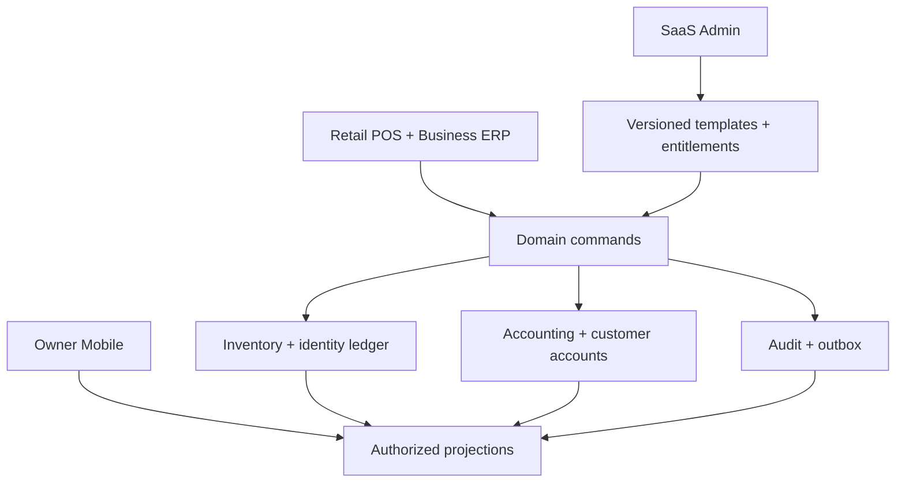

# LakBiz complete platform architecture

This is the implementation contract recovered from the original proposal: enhance `leed56/Subjects`, preserve existing workflows, and use one configurable platform rather than separate industry applications.

## Four product surfaces

| Surface | Purpose | Shared boundaries |
| --- | --- | --- |
| Retail POS | Fast checkout, identities, tender, returns, customers, loyalty | Organization, location, stock allocation, immutable invoice, credit ledger |
| Business ERP | Purchasing, imports, warehouses, accounting, VAT, staff, BI | Shared inventory, document and financial ledgers |
| Owner Mobile | Cash, sales, receivables, stock risk, alerts and decisions | Owner-only financial projections; explicit business-day periods |
| SaaS Admin | Provisioning, subscriptions, support, templates, release rollouts | Platform-admin identity; audited tenant access; no implicit shop impersonation |

The existing Next.js / React / Supabase platform can support this structure. Preserve its auth, subscriptions, masked owner finance views, pharmacy allocation, textile physical rolls, vehicle records and return-accounting boundaries. Incrementally extract domain modules from the large store and synchronization file.

## Industry Template Engine

A template is an immutable, versioned contract with:

- Identity, localized names, product vocabulary and category taxonomy.
- Enabled modules and routes; subscription requirements; role policies.
- Product fields, field types, required conditions, validation rules and units.
- Inventory defaults: simple, lot, serial, variant, variant-lot, variant-serial or a dedicated vertical ledger.
- Workflow definitions and state transitions; owner approvals where genuinely needed.
- Organization-configured tax behavior, invoice presets, reports, alerts and dashboard projections.
- Compatibility range, additive migration references, rollout cohort and rollback metadata.

`src/lib/erp/industry-templates.ts` is the typed runtime/demo registry. Existing production sector, feature, field, category and tracking registries remain authoritative for live workflows. They should converge on this contract after adapter verification; configuration must never silently convert a live product's tracking mode or erase a ledger.

| Industry | Identity and units | Specialist workflow |
| --- | --- | --- |
| Grocery | Packs, weights, optional dated lots | Fast POS, FEFO for dated goods, replenishment |
| Pharmacy | Batch, expiry, strength, pack | FEFO, prescription metadata, quarantine, inspection |
| Cosmetics | Shade, pack, batch, expiry, labelled PAO | Collections, shade availability, beauty rewards |
| Textile / fashion | Roll, shade, dye lot, width, metre / yard | Reservations, measured cuts, remnants, dispatch, trade credit |
| Electronics | Serial, model, colour, warranty | Unit allocation, service inspection, return trace |
| Mobile phones | IMEI, storage, colour, new / refurbished | Unit trace, compatible repair parts |
| Auto spare parts | OEM, part number, fitment, bin | Compatibility search, stock ageing, replenishment |
| Vehicle dealership | VIN / chassis, engine, registration | Import, reconditioning, finance, handover, ageing |
| Hardware | Material, dimension, pack, weight | Trade accounts, units, job/site delivery |
| Stationery / books | ISBN, author, publisher, paper and pack size | School-season replenishment, kits and books |
| Wholesale / distribution | Cases, pack conversions, tier pricing, optional lot | B2B orders, credit, dispatch, collections |
| Electricals | Rating, cable length, variant | Measurement and site purchasing |
| Footwear | Style, size, colour | Size-run inventory, reservations, returns |
| AC / HVAC | Unit serial, asset, part and installation identity | Jobs, technician schedule, installed assets, recurring service |

Template Studio stages a version, checks compatibility, verifies owner/manager/cashier flows in isolated tenants, deploys compatible schema and app, then rolls out by cohort. A new version only changes defaults for new records unless an explicit, tested conversion is selected. Historic documents retain their original template and tax-policy versions.

## Core engine contracts

| Engine | Commands and invariants | Existing adapters / new design |
| --- | --- | --- |
| Product catalogue | Create/update/retire; preserve referenced product identities | Existing products, category blueprint, custom fields; add missing industry vocabulary |
| Purchasing | Order → approved → partial receipt → received/cancelled; ordering never creates stock | Existing PO, receipt and supplier engines; atomic posting should replace sequential snapshots |
| Imports | Draft → booked/in transit → customs → partial receipt → closed | General shipment and landed-cost extension; preserve textile/vehicle integrations |
| Inventory | Immutable movements; location and identity allocation; no negative available stock | Existing aggregate and advanced ledgers; dedicated textile rolls remain separate |
| Damage/loss | Reason, identity, quantity, approver/actor; stock and accounting in one transaction | Existing write-off and return-hold resolution; general approval and location support |
| POS/wholesale | Price/tax/cost snapshots; tender sum equals invoice; credit limit checked under lock | Existing atomic retail/tenders, textile checkout and customer pricing |
| Returns | Original invoice line/identity; cumulative return limit; inspection and credit issuance separated | Existing returns, credit notes, exchanges and owner accounting adjustments |
| Accounting | Balanced immutable journals; source idempotency; ledger/subledger reconciliation | General ledger extension; preserve existing owner financial privacy |
| VAT | Versioned effective rate and registration; eligible input VAT; credit-note adjustments | Existing VAT UI/engine; current invoice compliance needs official verification |
| Customer accounts | Credit sale, receipt, allocation, terms, overdue/ageing | Existing customer payments and textile credit terms |
| Loyalty | Earn, redeem, expire, reverse; immutable point movements and original policy snapshot | New production point ledger; sample checkout implements earn/redeem/reverse |
| Staff/access | Role-scoped commands, active membership, expiry, audit | Existing org-members/team and HVAC workforce; extend generic workforce without widening finance |
| BI/alerts | Business timezone, stable pagination, net returns, explicit costs and periods | Existing dashboard/report engines; all-industry owner projections |
| Subscriptions | Active/trial write; expired read-only; module + role + template entitlement | Existing plans/addons/subscription guards; verify webhook and expiry paths |
| Platform release | Staged version, compatibility result, cohort, activation, audit and rollback | New template release-control persistence; sample Studio currently verifies configuration only |

### Imports and landed cost

Store supplier currency and the documented invoice exchange rate. Keep payment-date FX differences separate from acquisition cost. Capitalize goods, freight, insurance, non-recoverable duty/tax and attributable clearing costs. Recoverable input VAT remains outside inventory cost. Allocate by goods value, quantity or a validated weight/volume basis. Use largest-remainder allocation to preserve every minor unit.

A receipt snapshots allocation, identity, location, cost and tax treatment. Partial receipts allocate only the eligible fraction; final receipt resolves residual cents. Posted shipments cannot be edited in place: correct by reversal and a replacement document. Reconditioning is a separate vehicle acquisition-cost boundary.

### Stock and locations

`stock_movements` is the quantity authority; availability = on hand − reservations − holds. Aggregate product stock is a projection, never a second independently editable source. Lot, serial and variant allocations must point to the same organization and location as the invoice/receipt. Units have exact conversion factors; measured textile quantities retain metre/yard and roll identity.

Transfers use dispatch/receive states with an in-transit location. A completed transfer decreases the source and increases the destination without changing total organizational stock or acquisition cost. Counts use an explicit cut-off, counted quantity, variance and adjustment event. Opening allocations must reconcile to the existing quantity rather than duplicating stock.

### Double-entry and cost

Persist decimal money as fixed precision or integer minor units; use deterministic rounding per document. Each posting batch has organization, source kind/id/version, currency, date, actor and idempotency key. A journal contains at least two valid account lines with equal debits and credits. Posting and source-state change happen in one database transaction.

- Sale: cash/card-clearing/receivable debit; revenue and output VAT credits; historical COGS debit and inventory credit.
- Purchase/import: inventory and eligible input VAT debits; supplier payable or settlement credit.
- Write-off: stock-loss debit and inventory credit.
- Return credit note: reverse invoice values, original tax and original cost; physical disposition decides inventory versus loss.
- Cash/bank settlement and FX difference: separate events; preserve source invoice currency and rate.

Inventory valuation needs cost layers or weighted-average carrying value with residual-cent handling; rounded displayed unit costs are not an authoritative carrying-value ledger. Reconcile journals, customer/supplier balances, tender clearing and inventory valuation explicitly.

## Additive production schema design

Every table has `organization_id`; compound references prevent cross-tenant joins. Owner financial tables get owner-only RLS and module/subscription checks; operational tables use the actual role boundary. Anonymous access is denied. Existing masked views remain the operational interface. New SQL functions default to security invoker; privileged posting requires an independently reviewed authorization boundary, restricted EXECUTE and explicit actor checks.

| Domain | Proposed records |
| --- | --- |
| General imports | import_shipments, import_lines, shipment_costs, import_receipts, receipt_cost_allocations |
| General locations | warehouse_locations, stock_reservations, stock_movement_locations, transfer_orders, transfer_lines, stock_counts |
| Accounting | ledger_accounts, journal_batches, journal_lines, source_postings, reconciliation_runs |
| Loyalty | loyalty_policies, loyalty_memberships, point_events, reward_redemptions |
| Templates | industry_template_versions, template_compatibility_runs, tenant_template_assignments, template_rollouts |
| Reliable operations | command_idempotency, domain_outbox, notification_attempts, domain_audit |

These are design contracts, not a claim that the new production tables already exist. The shipped migrations in this PR add only missing industry provisioning/configuration and preserve all live quantities.

## Command architecture and reliability

Use a domain service per boundary with typed commands, schema validation, membership, role, template, subscription and organization checks before posting. Use database transactions and row locks on stock, credit balances and document state. Idempotency keys survive retry and reconnect. Lock multiple identities in stable order. Append audit and outbox records inside the transaction; send messages after commit, with delivery retries.

The browser never calculates an authoritative payable, profit, tax claim or available quantity from untrusted submitted values. It can preview the calculation; the database recomputes it. Do not use user-editable auth metadata for role decisions. Re-read role/entitlement state at sensitive writes. Owner projections must not fetch secret cost fields for operational roles.

The new demonstration engine runs locally with synthetic data and reproduces these transaction rules, but it is not a substitute for transactional production adapters.

## Complete UI system

Use the current navy/emerald premium direction: restrained typography, pearl work surfaces, a persistent navy navigation rail, clear numeric hierarchy, subtle borders, purposeful accent colours per industry, and a small reusable component vocabulary. Primary action is visible once per workspace. All forms have named controls, visible validation, focus management, keyboard support and an accessible confirmation boundary for loss/returns.

The design suite ships at `/demo` and `/demo/{industry}/{workspace}`. Every original page and additional control page has an interactive sample surface. See `PREMIUM_UI_PAGE_SPEC.md` and `CLIENT_DEMO_GUIDE.md`.

## Further enhancements discovered

1. Replace multi-request purchasing snapshots with transactional commands; sequential supplier/product/document writes can leave partial state after a network failure.
2. Reduce `business-sync.ts` and the app-store provider into domain adapters with shared idempotency, bounded retries and typed error classification.
3. Reconcile inventory and financial subledgers; existing report totals should not be presented as audited accounts without this check.
4. Complete Tamil translation coverage rather than treating English fallback as localization completion.
5. Apply Sri Lankan business-day handling across dashboards, invoice sequences, trends, expiry and reporting periods.
6. Make source paging deterministic and add bounded pagination for every high-volume operational reader.
7. Extend owner mobile to every industry, with return-adjusted sales/profit, verified collections and costs.
8. Introduce cross-location reservations and transfer reconciliation before advertising fully integrated multi-branch POS.
9. Add persistent template release management and staged tenant rollout with rollback history.
10. Finish a role/industry regression matrix covering payments, returns, receipt retries, expiry, oversell, offline reconnect and subscription expiry.
11. Add audit visibility, outbox delivery health and sync-conflict diagnosis so owners can see why a record is pending.
12. Improve invoice search/export, scanner focus, dense table usability, mobile sticky actions and print views consistently.

## Release boundaries

Public demos are synthetic and browser-local. They mount no live auth, subscription, app-store synchronization or service worker. Demo credentials never create a Supabase session. Each industry has independent sample storage; reset affects only that industry.

Production migrations must ship with compatible application code. Do not enable missing sectors while deployed clients still coerce them to grocery. Live mutations and migration application are separate from the isolated design-suite preview. Every unimplemented production adapter is tracked openly in `ERP_CAPABILITY_AUDIT.md`.
